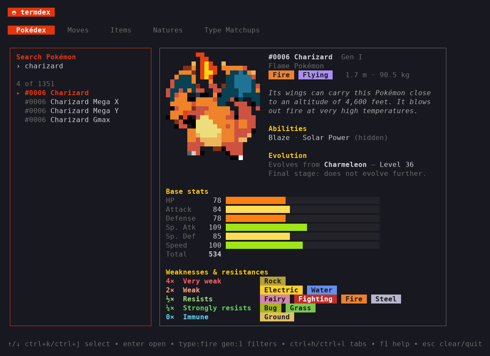
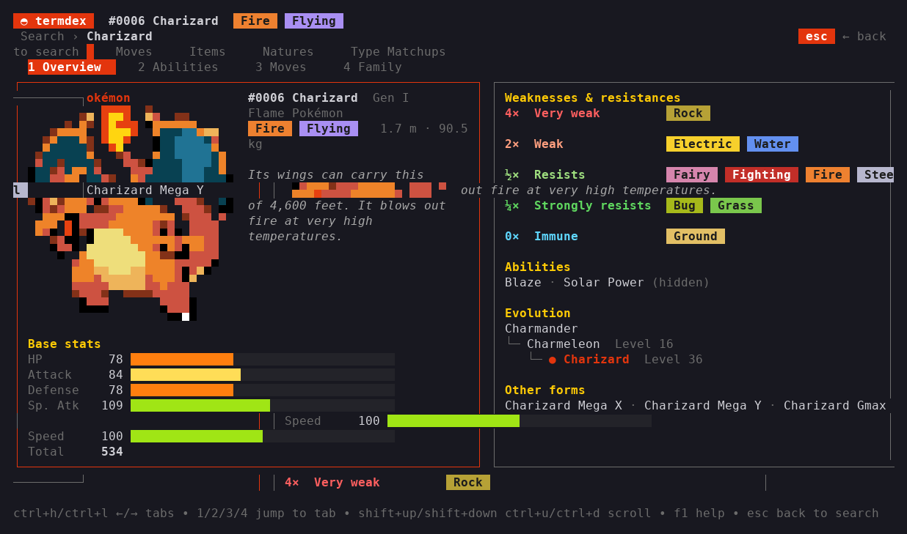
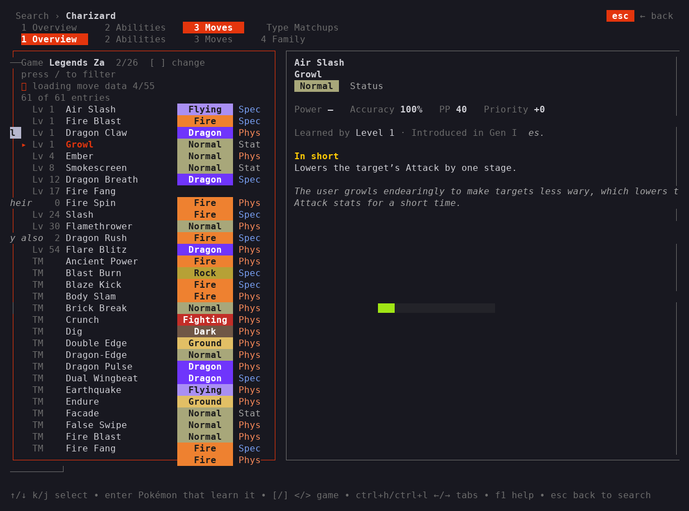
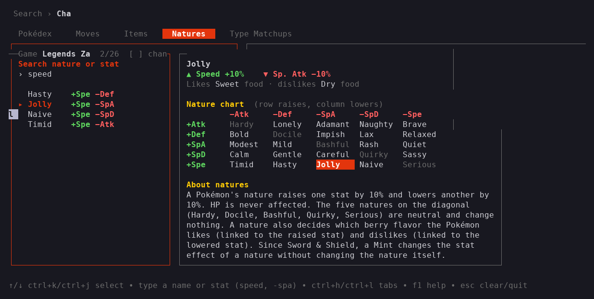
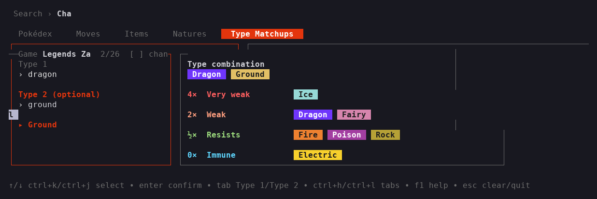

<h1 align="center">◓ termdex</h1>

<p align="center">
  A fast, offline-friendly Pokédex for your terminal: Pokémon, moves, items, natures and
  type matchups, with pixel-art sprites.
</p>

<p align="center">
  <a href="https://github.com/JoaoASimoes/termdex/actions/workflows/ci.yml"></a>
  <a href="https://github.com/JoaoASimoes/termdex/releases"></a>
  <a href="https://goreportcard.com/report/github.com/JoaoASimoes/termdex"></a>
  
  <a href="LICENSE"></a>
</p>

<p align="center">
  
</p>

## Features

- **Every Pokémon and form** in National Pokédex order, with a live preview as you type or
  scroll: pixel-art sprite, description, base stats, abilities, evolutions and weaknesses.
- **Typo tolerant search** (`charizrd` → Charizard) and **filters**: `type:fire`, `gen:1`,
  or both with a name (`type:dragon gen:4 gar`).
- **Full entries** with Overview, Abilities, Moves (the move pool of every game, with
  filter) and Family (evolution line, Mega/Gmax/regional forms, gender differences).
- **Moves, items and natures** to browse on their own, plus a **type matchup** calculator
  for any one or two types.
- **Everything is linked**: from a move, item or ability to the Pokémon that learn, hold or
  have it, and from there to their entries, with a breadcrumb and back history.
- **Works offline**: all data from [PokeAPI](https://pokeapi.co) is cached locally after the
  first look.
- **Yours to configure**: every key binding, the colours and a few options in a TOML file;
  `?` shows the keys of the current screen.
- **Plain subcommands** for quick lookups and scripts.

<table>
  <tr>
    <td></td>
    <td></td>
  </tr>
  <tr>
    <td></td>
    <td></td>
  </tr>
</table>

## Installation

**Pre-built binaries** for Linux, macOS and Windows are on the
[Releases](https://github.com/JoaoASimoes/termdex/releases) page: download the archive for
your system, extract it and put `termdex` somewhere on your `PATH`.

**With Go** (1.26 or newer; an older `go` fetches the right toolchain by itself):

```bash
go install github.com/JoaoASimoes/termdex/cmd/termdex@latest
```

This installs into `$(go env GOPATH)/bin` (usually `~/go/bin`), which should be on your `PATH`.

**From source**:

```bash
git clone https://github.com/JoaoASimoes/termdex.git
cd termdex
make install        # or: make build, for ./termdex
```

The interface looks best in a terminal with 24-bit colour (most modern terminals) and at
least 100×30 characters; smaller terminals work too, with scrolling.

## Quick start

```bash
termdex
```

Start typing a name, move through the list with `↑`/`↓` (or `ctrl+j`/`ctrl+k`) and press
`enter` to open an entry. `ctrl+h`/`ctrl+l` switch between the Pokédex, Moves, Items, Natures
and Type Matchups tabs, `esc` goes back, and **`?` shows every key** of the screen you are
on. The full list is in [docs/keybindings.md](docs/keybindings.md).

### Subcommands

```
termdex pokemon <name>        weaknesses of a Pokémon (with its sprite)
termdex type <type> [type2]   weaknesses of one or two types
termdex types                 list the types
termdex config path|init|show|check
termdex version
```

```
$ termdex type steel fary
'fary' not found; using 'fairy'.

Type(s): Steel / Fairy

  2×   Weak              Fire, Ground
  ½×   Resists           Dark, Fairy, Flying, Grass, Ice, Normal, Psychic, Rock
  ¼×   Strongly resists  Bug
  0×   Immune            Dragon, Poison
```

Options go before the command: `--refresh` downloads the data again, `--config <file>` uses
another config file.

## Configuration

termdex works without any configuration. To change key bindings, colours or options:

```bash
termdex config init     # writes the commented defaults to ~/.config/termdex/config.toml
termdex config check    # validate after editing
```

```toml
[colors]
accent = "#1E66F5"

[keys.search]
down = ["down", "ctrl+d"]
up = ["up", "ctrl+u"]
```

See [docs/configuration.md](docs/configuration.md) for every setting and
[configs/config.example.toml](configs/config.example.toml) for the default file.

## Documentation

- [Configuration](docs/configuration.md): config file, colours, options, flags, environment
  variables and the cache.
- [Key bindings](docs/keybindings.md): every action, its default keys and how to change it.
- [Changelog](CHANGELOG.md)

## Contributing

Contributions are welcome! See [CONTRIBUTING.md](CONTRIBUTING.md) for the development setup,
the project layout and guidelines, and please follow the [Code of Conduct](CODE_OF_CONDUCT.md).
Security issues: see [SECURITY.md](SECURITY.md).

## Acknowledgements

- [PokeAPI](https://pokeapi.co) for all the data and the
  [sprites](https://github.com/PokeAPI/sprites). Please consider
  [supporting them](https://pokeapi.co/about).
- [Charm](https://charm.sh) for [Bubble Tea](https://github.com/charmbracelet/bubbletea),
  [Bubbles](https://github.com/charmbracelet/bubbles) and
  [Lip Gloss](https://github.com/charmbracelet/lipgloss).

## License

[MIT](LICENSE).

Pokémon and Pokémon character names are trademarks of Nintendo, Game Freak and Creatures
Inc. This is an unofficial fan project, not affiliated with or endorsed by them.
